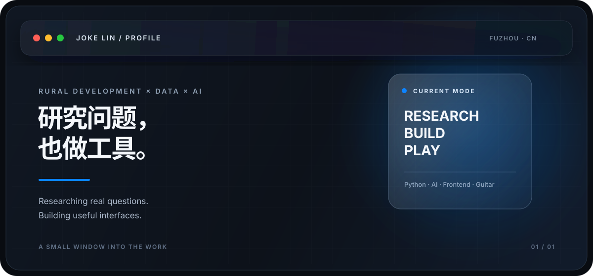

  

  <a href="https://jokeslin.github.io/">PERSONAL SITE ↗</a>&nbsp;&nbsp;·&nbsp;&nbsp;
  <a href="https://github.com/JokesLin">GITHUB ↗</a>&nbsp;&nbsp;·&nbsp;&nbsp;
  <a href="https://github.com/JokesLin/EchoMusic">ECHOMUSIC ↗</a>

 

<table>
<tr>
<td width="50%" valign="top">

### ABOUT

**Joke Lin / 林有崧**

福州 · 福建农林大学农村发展硕士在读。

我关注真实问题，也在用数据、AI 和前端把想法做成可使用的东西。

</td>
<td width="50%" valign="top">

### STATUS

`OPEN TO COLLABORATION`

研究 × AI / 数据工具  
数字产品与静态站点  
把复杂问题讲清楚

</td>
</tr>
</table>

## NOW

| WINDOW | FOCUS |
| --- | --- |
| `01 / RESEARCH` | 农村发展、数字农业、森林碳汇，以及技术如何进入具体场景 |
| `02 / BUILD` | Python、数据分析、AI 协作、前端与静态站点 |
| `03 / OUTSIDE` | 吉他、田野观察，以及持续整理自己的工作方法 |

## WORKSPACE

<table>
<tr>
<td width="50%" valign="top">

### [PERSONAL PORTAL ↗](https://jokeslin.github.io/)

一个持续更新的数字个人空间，收纳研究笔记、工具、文章、音乐与实验性作品。

`HTML` `CSS` `JavaScript` `GitHub Pages`

</td>
<td width="50%" valign="top">

### [ECHOMUSIC ↗](https://github.com/JokesLin/EchoMusic)

一个简约的第三方酷狗概念版音乐播放器，记录我对音乐产品、界面与交互的探索。

`MUSIC` `UI` `FRONTEND EXPLORATION`

</td>
</tr>
</table>

## RESEARCH LENS

我关心的不只是“技术能不能做出来”，还包括它是否被真实使用、是否降低理解门槛，以及它能否在具体的地方产生一点作用。

- 乡村发展与农村社会
- 数字农业与技术采纳
- 森林碳汇与生态治理
- 数据分析与研究工作流

## TOOLKIT

`Python` · `Pandas` · `Stata` · `SPSS` · `HTML/CSS/JavaScript` · `Git` · `AI-assisted workflow`

## CONTACT

如果你正在做研究、数据工具、AI 工作流或小型数字产品，欢迎从我的[个人站点](https://jokeslin.github.io/)开始了解，也可以直接在 [GitHub](https://github.com/JokesLin) 找到我。

ARCHIVE / NOTES

这里不是完整简历，而是一份持续更新的工作索引：研究在这里留下问题，项目在这里留下答案，未完成的实验也可以保留痕迹。

 

  Built with curiosity · designed for clarity · maintained one small window at a time.

