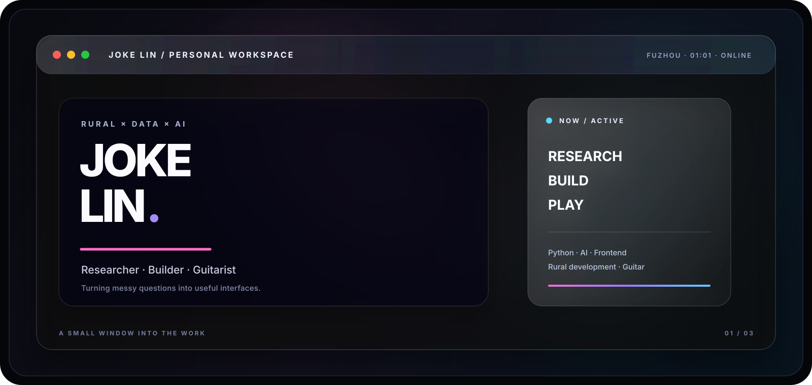
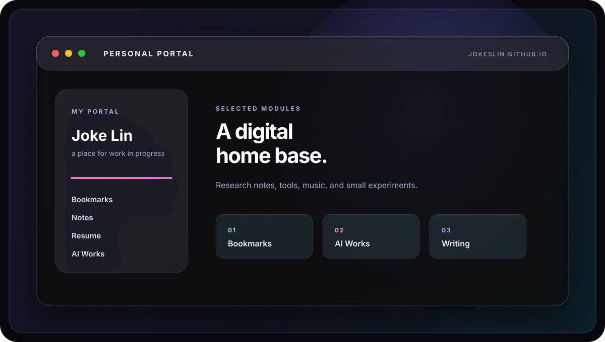
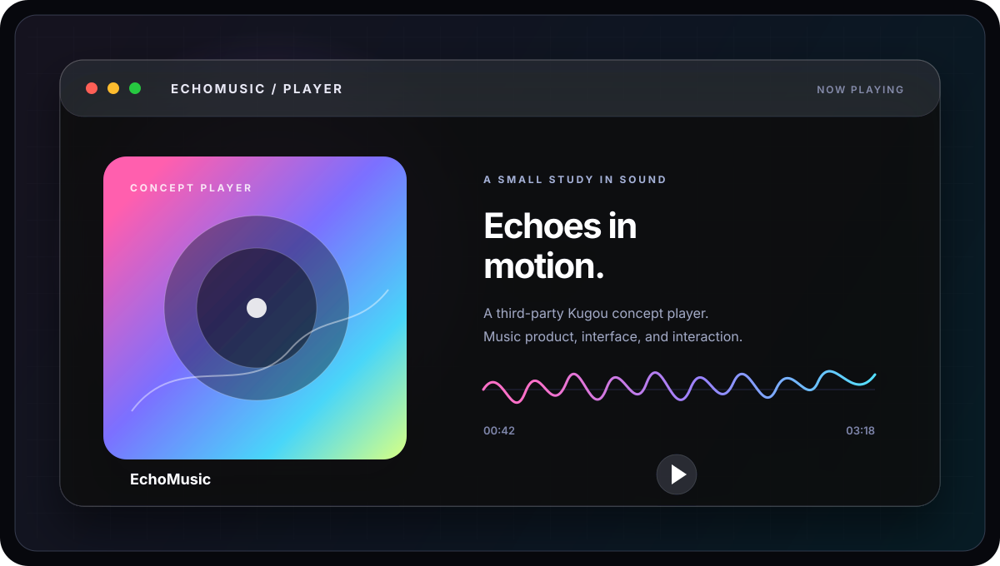

  
   
   
  <a href="https://jokeslin.github.io/">VISIT PORTAL ↗</a>&nbsp;&nbsp;·&nbsp;&nbsp;
  <a href="https://github.com/JokesLin/EchoMusic">OPEN ECHOMUSIC ↗</a>&nbsp;&nbsp;·&nbsp;&nbsp;
  <a href="https://github.com/JokesLin">FIND ME ON GITHUB ↗</a>

 

## 01 / NOW

<table>
<tr>
<td width="33%" valign="top">

**RESEARCH**

Rural development  
Digital agriculture  
Forest carbon

</td>
<td width="33%" valign="top">

**BUILD**

Python  
Data workflows  
AI-assisted tools

</td>
<td width="33%" valign="top">

**OUTSIDE**

Fuzhou, China  
Guitar  
Field notes

</td>
</tr>
</table>

> **Researcher. Builder. Rural × Data × AI.**  
> Turning messy questions into useful interfaces.

## 02 / WORKS

<table>
<tr>
<td width="50%" valign="top">

### [PERSONAL PORTAL ↗](https://jokeslin.github.io/)

A digital home base for notes, tools, writing, music, and experiments.

HTML · CSS · JavaScript · GitHub Pages

</td>
<td width="50%" valign="top">

### [ECHOMUSIC ↗](https://github.com/JokesLin/EchoMusic)

A third-party Kugou concept player — a small study in sound, interface, and interaction.

Music · UI · Frontend exploration

</td>
</tr>
</table>

## 03 / SIGNAL

**Fujian Agriculture and Forestry University · Rural Development MSc**  
Currently exploring the space between social research, data, AI, and things people can actually use.

ABOUT / STACK

`Python` · `Pandas` · `Stata` · `SPSS` · `HTML/CSS/JavaScript` · `Git` · `AI-assisted workflow`

I care about whether a tool is useful in a real context, whether it lowers the cost of understanding, and whether it leaves something concrete behind.

## 04 / CONTACT

Open to thoughtful collaborations around research, data tools, AI workflows, and small digital products.

[PERSONAL SITE ↗](https://jokeslin.github.io/) · [GITHUB ↗](https://github.com/JokesLin)

 

  Built with curiosity · designed for clarity · still in progress.

